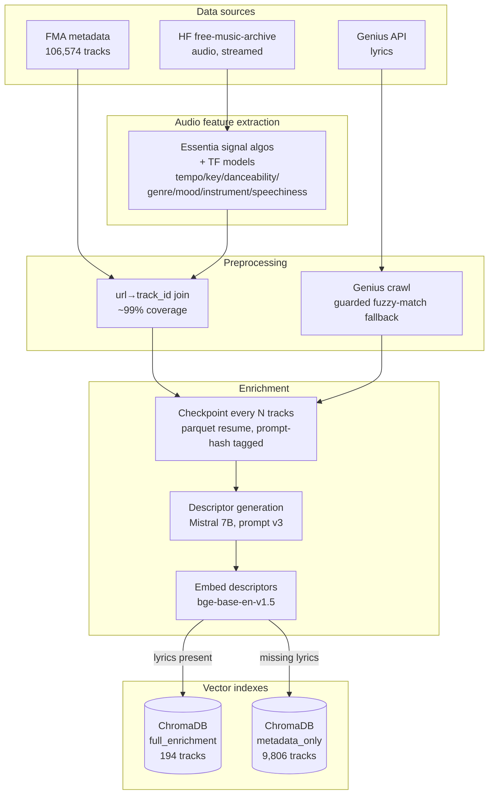
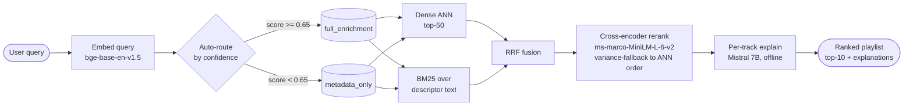

# NLP Music Playlist Retrieval System

A free-text query → ranked 10-track playlist with per-track explanations, built as a
recommender-as-search system: LLM-generated track descriptors, dense + lexical retrieval,
cross-encoder reranking, and confidence-based dual-index routing. A personal project built to
explore the full architecture behind modern music recommenders — data pipeline, LLM-based
feature engineering, dense retrieval, reranking, and offline evaluation — end to end.

---

## 1. Problem framing & scope

Standard playlist recommendation assumes either collaborative-filtering signal (user-item
interactions) or a fixed taxonomy of genre/mood tags. This project reframes the problem as
**semantic search over a document collection**, where each "document" is an LLM-generated
natural-language descriptor of a track (mood, tempo feel, genre, lyrical themes, plus a short
narrative), synthesized from audio features and lyrics. A user query like *"chill rainy
afternoon jazz with some melancholy"* is embedded and matched against these descriptors via
dense retrieval, refined with lexical (BM25) signal, fused, and reranked — the same
architecture pattern (embed → ANN retrieve → rerank) used in production recommender and
search systems.

**In scope for this version:**
- End-to-end offline pipeline: FMA metadata → Essentia audio-feature extraction → Genius
  lyrics crawl → Mistral 7B descriptor generation → dual ChromaDB indexing
- Two-stage retrieval: bi-encoder ANN + BM25, fused via Reciprocal Rank Fusion (RRF)
- Cross-encoder reranking with a variance-based fallback
- Confidence-based auto-routing between a lyrics-grounded index and a metadata-only index
- A five-config ablation matrix, evaluated with NDCG@10 / MRR / Precision@10 / Novelty@10
- A three-command CLI (`retrieve`, `rerank`, `explain`) as the serving surface

**Not built in this version:**
- Web UI / audio playback — the system is currently driven through the CLI and eval harness;
  a UI is a natural next step rather than something ruled out (see [§9](#9-what-id-do-differently--future-work))
- Real-time Spotify OAuth — moot in practice, since the relevant endpoint was restricted for
  new apps in November 2024 anyway (see [§4](#4-the-spotify-api-deprecation-pivot))
- A deployed HTTP endpoint — the CLI covers the same architecture without the added
  operational surface of a running service; also a candidate future direction
- Collaborative filtering / matrix factorization — no real user-interaction data exists to
  train on, and a synthetic user-item matrix wouldn't be meaningful
- Fine-tuning the LLM used for descriptor generation — no ground-truth human-written
  descriptors exist to fine-tune against; prompt engineering is the right tool here instead
- Multi-language lyrics support — restricted to English to keep cleaning/eval/prompting logic
  simple

A further tier of stretch goals (popularity debiasing, MLflow, query expansion, embedding
quantization, contrastive fine-tuning, A/B testing, MMR coherence reranking) is designed in
`docs/scope.md` but not implemented — see [§9](#9-what-id-do-differently--future-work).

---

## 2. Architecture overview

### Offline pipeline



### Query-time flow



Three CLI commands map directly onto this diagram — `retrieve` (embed → route →
dense+BM25 → RRF), `rerank` (cross-encoder stage), `explain` (per-track narrative) — kept
decomposed rather than merged into one `recommend` command so each stage is independently
testable and its latency independently measurable.

---

## 3. Key architectural decisions

**Model selection.** The bi-encoder is `BAAI/bge-base-en-v1.5`, chosen over `all-MiniLM-L6-v2`
(faster, but a real retrieval-quality gap) and `text-embedding-3-small` (breaks the
local-first, fine-tunable design this project is built around). It scores well on retrieval
benchmarks and is built for the contrastive fine-tuning path described in
[§9](#9-what-id-do-differently--future-work). The cross-encoder is
`cross-encoder/ms-marco-MiniLM-L-6-v2`, fast enough to rerank 50 candidates in ~12ms on an M1
Max. The descriptor/explanation LLM is Mistral 7B Instruct — a 3B variant tested on sample
tracks showed a real quality drop on abstract mood/theme extraction, so 7B stayed despite the
larger footprint, kept manageable via Q4_K_M quantization (~4.5GB).

The LLM backend is swappable (`config.enrichment.llm_backend`): local development runs LM
Studio serving an MLX build of Mistral 7B for faster Apple Silicon inference, while the
Docker/Linux path uses an Ollama sidecar, since MLX doesn't run in a Linux container. Both
constrain descriptor output via JSON-schema-guided decoding, with Pydantic validation as the
actual gate regardless of backend.

**Data pipeline.** Batch, not streaming — the catalog is static and built once. Descriptor
generation checkpoints every 100 tracks with an atomically-written manifest, so a crash
partway through a multi-hour LLM batch loses minutes of work, not hours. Catalog ingestion is
validated strictly (a bad fuzzy join is a hard failure, since it would otherwise quietly
poison hours of downstream generation); enrichment quality is validated leniently (missing
lyrics stay in the catalog tagged `metadata_only` rather than getting dropped). Two separate
ChromaDB collections — one for lyrics-grounded tracks, one for metadata-only — exist because
mixing them would make it impossible to say cleanly whether lyrics grounding actually helps
retrieval.

**Fine-tuning infrastructure.** The plan (sketched out in `src/models/finetune.py`) is to
fine-tune the bi-encoder with the `sentence-transformers` Trainer API, combining in-batch
negatives with mined hard negatives (0.7/0.3 weighting), early-stopping on NDCG@10 rather than
validation loss since loss can keep falling while retrieval quality plateaus. Not yet
implemented — see [§9](#9-what-id-do-differently--future-work).

**Experiment tracking.** TensorBoard, not MLflow or W&B — runs entirely locally, integrates
natively with PyTorch, and needs no account setup. Skipped the embedding projector as more
setup effort than the marginal insight it buys over the three tracked metric groups (training
dynamics, pipeline health, retrieval quality).

**Serving.** A three-command CLI (`retrieve`, `rerank`, `explain`) instead of an HTTP API —
each stage is independently testable and has its own Pydantic-validated response schema,
checkable in CI without standing up a server. This keeps the two-stage retrieval architecture
explicit rather than hiding it behind a single endpoint.

**Config & routing.** One `config.yaml`, Pydantic-validated at startup — any missing or
malformed key fails immediately rather than surfacing later as a hard-to-trace bug. Query
routing between the two indexes is confidence-based: cosine similarity between the query
embedding and the centroid of the top-5 `full_enrichment` matches; below the threshold (0.65,
tunable), the query falls back to the broader metadata-only index.

---

## 4. The Spotify API deprecation pivot

The original design pulled tempo, energy, valence, acousticness, and danceability straight
from Spotify's `audio-features` endpoint via `spotipy`, fuzzy-joined against FMA on
(artist, title). That endpoint was restricted for new API apps in November 2024, cutting this
off before the project could lean on it (`SpotifyClient` is still in the codebase but unused).

The fallback was FMA's bundled `echonest.csv` — a static, pre-computed feature table covering
only 13,129 of FMA's 106,574 tracks. Joining against it drops over 93,000 tracks for lack of
features, capping the catalog well below the original 3,000–5,000-track target.

The actual fix was to extract audio features directly from raw audio using Essentia,
streaming source audio from a HuggingFace mirror of FMA rather than downloading it in bulk.
That meant:

- Recovering a join key the HF dataset doesn't carry — matching each audio file back to its
  FMA `track_id` via URL, with a filename fallback for the ~1% that don't match.
- Building a small model registry around Essentia: classical DSP (tempo, key) plus three
  TensorFlow model families — genre, mood, and instrument classifiers riding on Discogs-effnet
  embeddings, and a YAMNet AudioSet pass supplying both a speechiness proxy and a mood signal.
- Accepting a real schema change, not just a new source for the same fields — valence and
  acousticness have no Essentia equivalent and are dropped from the descriptor prompt outright
  rather than approximated; danceability becomes a binned category instead of a continuous
  score; speechiness is re-derived from AudioSet speech-class probability mass, which means the
  filtering threshold tuned for the old signal needs revisiting (see
  [§9](#9-what-id-do-differently--future-work)).
- Running extraction on CPU on Apple Silicon — Essentia's bundled TensorFlow build has no GPU
  acceleration path on macOS, so scaling up further would lean on CPU parallelism across
  machines rather than GPU offload.

Net result: the coverage ceiling moved from ~13K to effectively all of FMA, at the cost of a
schema migration and slower, CPU-bound extraction. The current 10,000-track catalog reflects
this pipeline, not the original Spotify-based design.

---

## 5. Failure modes & mitigations

A few of the more concrete ones, out of a longer register kept in `docs/failure_modes.md`:

- **Sentinel values look like real data.** An audio-feature source can return `0.0` for an
  unanalyzed track rather than a missing value — a `tempo: 0.0` reads as "no discernible pulse"
  instead of "unmeasured." Hard range validation nulls out anything outside a sane range
  rather than passing it downstream into a prompt.
- **Instrumental tracks get hallucinated lyrics.** Left unconstrained, the LLM will invent
  lyrical themes for tracks that have none. A schema-level check rejects any descriptor with
  non-null lyrical themes on a track flagged instrumental — a wrong-but-confident signal here
  is worse than a missing one, since it actively misdirects retrieval instead of just failing
  to help it.
- **Cross-encoder reranking can go flat.** The reranker was trained on web search text, not
  music semantics, so abstract or spatial queries sometimes produce near-uniform scores across
  all 50 candidates. When that happens, reranking falls back to the original ANN order rather
  than reshuffling on noise, and flags it in the response.
- **Two independent hardware fallback chains.** Essentia's TensorFlow inference and the
  encoder/reranker models each resolve their own compute device (GPU → Apple Metal → CPU)
  independently and log the choice once at startup — kept as separate axes in code, since
  conflating "which device runs feature extraction" with "which server runs the LLM" is an easy
  mistake to make.
- **Checkpoint / prompt-version drift.** Every descriptor checkpoint is tagged with a hash of
  the prompt template it was generated with; merging checkpoints from two different prompt
  versions raises rather than silently producing a half-populated column.
- **Index writes are staged, never direct.** A new ChromaDB index is always built into a
  staging directory, spot-checked, and only then atomically swapped into production — protects
  against the index quietly corrupting if a write gets interrupted mid-run.

---

## 6. Evaluation: results and honest caveats

The eval set is 10 hand-authored queries with self-labeled relevant tracks
(`eval/queries.json`) — standard practice at this scale, but worth being upfront about, since
it turned out to materially affect the numbers below. The catalog at eval time was 10,000
tracks: 194 with usable lyrics (`full_enrichment`) and 9,806 without (`metadata_only`). Metrics
are NDCG@10 (primary — rank-sensitive, handles graded relevance better than raw precision),
MRR, Precision@10, and Novelty@10, computed against `index_tier="auto"` retrieval. A fifth
planned ablation config (LLM query expansion) isn't built yet, so four configs are reported.

Two ablation runs are shown below — identical code and catalog, differing only in how the
relevant-track labels were pooled:

**Run 1 — labels pooled from BM25 candidates only**

| Config | P@10 | NDCG@10 | MRR | Novelty@10 |
|---|---|---|---|---|
| dense_only | 0.060 | 0.064 | 0.178 | 0.992 |
| bm25_only | 0.230 | 0.261 | 0.448 | 0.980 |
| hybrid_rrf | 0.170 | 0.184 | 0.409 | 0.989 |
| hybrid_rerank | 0.190 | 0.198 | 0.406 | 0.988 |

**Run 2 — labels additionally pooled from dense retrieval's own top-10**

| Config | P@10 | NDCG@10 | MRR | Novelty@10 |
|---|---|---|---|---|
| dense_only | 0.580 | 0.619 | 0.750 | 0.992 |
| bm25_only | 0.270 | 0.305 | 0.503 | 0.980 |
| hybrid_rrf | 0.410 | 0.431 | 0.633 | 0.989 |
| hybrid_rerank | 0.340 | 0.345 | 0.561 | 0.988 |

The gap between the two runs is the actual finding. With an incomplete label set, any
relevant track a system retrieves that isn't in the label set counts as wrong, so whichever
retriever the labels happened to be sourced from ends up looking artificially strong. Run 1's
labels came from BM25 candidates, so `dense_only` scoring 0.064 NDCG doesn't mean dense
retrieval failed; it was returning tight, genuinely on-topic clusters with healthy cosine
similarity (0.55–0.70) that simply weren't in the label set yet. Adding dense's own top-10 to
the labels in Run 2 sent `dense_only` to 0.619 while `bm25_only` barely moved, confirming the
bias — but Run 2 now favors dense the same way Run 1 favored BM25. The honest read is that the
true ranking sits somewhere between the two runs.

Dense retrieval is the strongest single retriever on this catalog. 
However, we do not fully know yet whether reranking or RRF fusion actually help because the reranker 
is not trained on music text and BM25 is weak over largely templated metadata-only descriptors.
([§9](#9-what-id-do-differently--future-work)).


Limitations:
- With ~97% of the catalog lacking lyrics, LLM descriptors for those tracks collapse toward a
  template ("Mood: relaxing, meditative, sad. Tempo: moderate. Genre: Jazz…"), which clusters
  embeddings tightly and limits how much dense retrieval can discriminate.
- Only 194 of 10,000 tracks (1.94%) came back with usable lyrics from Genius, despite a
  fuzzy-match fallback and quota-aware retry logic working as designed — FMA's
  indie/Creative-Commons catalog just doesn't overlap much with what a mainstream lyrics
  database indexes. That thin coverage also means the dual-index design's core question — does
  lyrics grounding actually help retrieval? — isn't really testable yet at only 194 full-tier
  tracks.
- Novelty@10 sits at ~0.99 across every config and doesn't discriminate between them — FMA's
  play-count distribution is skewed enough that max-normalization pushes nearly every track's
  popularity score near zero.
- Retrieval quality was prioritized over latency throughout — there's no committed p50/p95
  latency budget, and per-track explanation generation is treated as an offline step rather
  than something optimized for request-time speed.

Reproduce with: `python scripts/run_eval.py --config config/config.yaml --print-table`.

---

## 7. Setup & usage

### Environment

```bash
# Python 3.12 (developed against a conda env; python:3.12-slim in Docker)
pip install -r requirements.txt
```

Notable pins from `requirements.txt` (reproducibility, not arbitrary):
- `pydantic==2.11.1` / `pydantic-settings>=2.8.0` — Pydantic v2 API (`model_validate`,
  `field_validator`) used throughout `src/data/schema.py`
- `essentia-tensorflow==2.1b6.dev1389` — the specific dev build verified to install on
  Apple-Silicon arm64/cp312; the newer `2.1b6.dev1438` is cp314-only and does not install here
- `chromadb==0.6.3`, `sentence-transformers==3.4.1`, `torch==2.6.0` — MPS backend target

API keys (`SPOTIFY_CLIENT_ID`/`SECRET` — currently unused dead code path, `GENIUS_ACCESS_TOKEN`)
live in `.env`, never in `config.yaml`. No `.env.example` is currently checked in.

### Running the pipeline end to end

```bash
make catalog       # FMA + Essentia + Genius -> catalog.parquet, lyrics.parquet
make descriptors    # Mistral 7B descriptor generation -> descriptors.parquet (checkpointed, resumable)
make index          # embed + dual ChromaDB index (staging -> validate -> atomic promote)
make eval           # full ablation matrix -> eval/results.csv + TensorBoard + printed table
```

or the single-command chain: `make pipeline` (catalog → descriptors → index).

`docker-compose up` runs the same four steps against an Ollama sidecar
(`docker-compose.yml`); switching `config.enrichment.llm_backend` from `lmstudio` to
`ollama` (and the corresponding `llm_base_url`) is required for the containerized path, since
MLX cannot run in a Linux container.

### CLI usage

```bash
python -m src.serving.cli retrieve \
  --query "chill rainy afternoon jazz with some melancholy" \
  --top-k 50 --index-tier auto --json-output

python -m src.serving.cli rerank \
  --query "chill rainy afternoon jazz with some melancholy" \
  --candidates candidates.json --top-k 10 --json-output

python -m src.serving.cli explain \
  --query "chill rainy afternoon jazz with some melancholy" \
  --tracks tracks.json --json-output
```

### Tests

```bash
pytest tests/ -v --cov=src --cov-report=term-missing
```

153 tests currently pass across `tests/data/`, `tests/models/`, `tests/serving/`, and
`tests/eval/`.

---

## 8. Tech stack summary

| Component | Tool/library | Why chosen |
|---|---|---|
| Bi-encoder (dense retrieval) | `BAAI/bge-base-en-v1.5` (sentence-transformers) | Strong retrieval quality among candidates considered; built for the contrastive fine-tuning path |
| Cross-encoder (reranking) | `cross-encoder/ms-marco-MiniLM-L-6-v2` | Purpose-built for query→short-text reranking; fast enough for real-time use (~12ms/50 pairs) |
| Lexical retrieval | `rank-bm25` (BM25Okapi) over descriptor text | Complements dense retrieval; fused via RRF, a standard hybrid-retrieval pattern |
| Vector store | ChromaDB (dual collections, cosine space) | Local-first, no external service; supports the full/metadata-only tier split |
| Descriptor/explanation LLM | Mistral 7B Instruct (LM Studio/MLX locally, Ollama in Docker) | Best quality/size tradeoff tested locally; backend-selectable |
| Audio feature extraction | Essentia (signal algos + Discogs-effnet/YAMNet TF models) | Direct extraction from raw audio after the Spotify/EchoNest coverage ceiling forced a pivot (§4) |
| Config & data contracts | Pydantic v2 + single `config.yaml` | Hard-fail on schema violations at ingest; every tunable parameter centralized and versioned |
| Data pipeline | pandas/pyarrow, checkpointed parquet | Fault-tolerant resume for multi-hour LLM batch jobs |
| Experiment tracking | TensorBoard | Zero external accounts; native PyTorch integration; simple in Docker |
| Serving | CLI (argparse + Pydantic request/response models) | Same architectural intent as an HTTP API without server plumbing |
| Fuzzy matching | rapidfuzz | Two-pass artist+title validation for the FMA↔Spotify/Genius joins |
| Testing | pytest, pytest-asyncio | 153 tests across data/model/serving/eval layers |

---

## 9. What I'd do differently / future work

**Highest priority — a balanced label pool.** The single biggest gap in the current eval
([§6](#6-evaluation-results-and-honest-caveats)) is that relevant-track labels were pooled
from BM25 and dense candidates separately rather than judging the top-k of every retrieval
config before scoring. That's the one piece of work that would let the ablation table make a
clean claim rather than a bounded one.

Other directions, roughly in the order I'd tackle them:

- **Popularity debiasing** — inverse-popularity reweighting at retrieval time, measured
  against before/after NDCG + Novelty@10. Currently blocked in practice by Novelty@10 being
  uninformative at this catalog's popularity distribution ([§6](#6-evaluation-results-and-honest-caveats))
  — would need to fix the popularity signal itself first.
- **Contrastive fine-tuning of the bi-encoder** (`src/models/finetune.py` has the design
  already sketched: sentence-transformers Trainer API, combined in-batch + hard-negative loss,
  NDCG@10-based early stopping) — not yet implemented. A natural next step given bge-base was
  chosen partly for its fine-tuning path.
- **LLM query expansion** — expanding a query like "chill rainy jazz" toward "slow tempo,
  minor key, acoustic piano-led jazz, Bill Evans, Kind of Blue adjacent" before embedding, and
  measuring the retrieval delta as a fifth ablation config.
- **A lightweight web UI** and **a deployed endpoint** — both natural extensions once the
  retrieval/reranking core is stable; not built yet because the CLI was enough to validate the
  architecture end to end.
- **MLflow experiment tracking** and **CI/CD** (test + eval-regression jobs, gated on the
  regression threshold already present in `config.yaml` but not wired to a CI job).
- **Increasing lyrics coverage.** 194/10,000 tracks with usable lyrics is thin enough that the
  dual-index architecture's core hypothesis (does lyrics-grounding improve retrieval?) can't
  currently be tested properly. Worth investigating whether a broader lyrics source closes
  this gap meaningfully on an indie/Creative-Commons catalog like FMA, versus accepting that
  metadata-only enrichment is this catalog's practical ceiling.
- **Re-tuning Essentia-derived thresholds against ground truth.** `speechiness_max` is still
  inherited from the old Spotify/EchoNest-calibrated era and hasn't been re-validated against
  the AudioSet-derived speechiness proxy introduced by the Essentia pivot.
