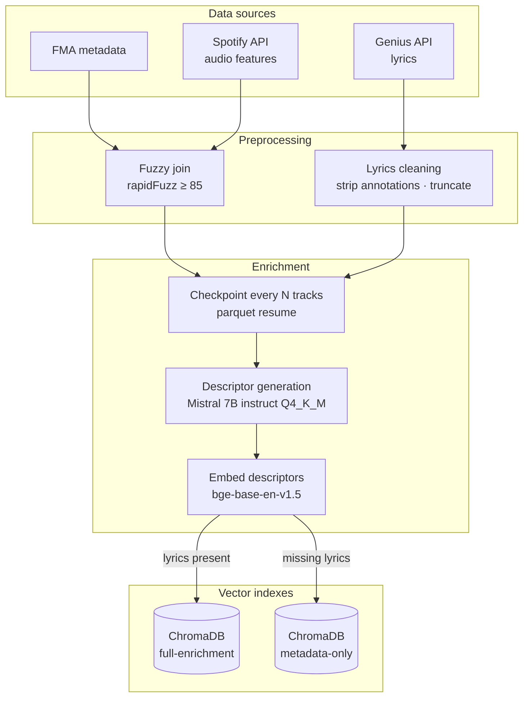
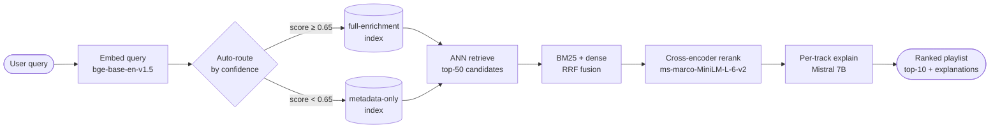

# Architecture Decision Record
## NLP Music Playlist Retrieval System

**Date:** 2026-03-21 | **Status:** Decided

---

## System Architecture

### Offline pipeline



### Query-time flow



---

## ADR-001 · Model Selection

**Context:** The system requires a bi-encoder for dense retrieval, a cross-encoder for reranking, and an LLM for structured descriptor generation and per-track explanations. Priority order: retrieval quality > fine-tunability > model size > latency.

**Decisions:**
- Bi-encoder: `BAAI/bge-base-en-v1.5` (109M params, ~430MB)
- Cross-encoder: `cross-encoder/ms-marco-MiniLM-L-6-v2`
- Descriptor/explanation LLM: Mistral 7B Instruct via a backend-selectable local transport

> **Amendment (2026-06-12):** The LLM transport is now backend-selectable
> (`enrichment.llm_backend`, see `src/models/llm_client.py`). Local Apple-Silicon
> dev defaults to **LM Studio** serving an **MLX** build
> (`mistral-7b-instruct-v0.3`) over the OpenAI-compatible API at
> `http://localhost:1234/v1`, to exploit MLX inference. The Docker/Linux path
> keeps the **Ollama** sidecar (`mistral:7b-instruct-q4_K_M`), since MLX cannot
> run in a Linux container. Descriptor output is constrained at the decoder via a
> JSON schema (`response_format: json_schema`, `strict: false`); `extract_json`
> + Pydantic validation remain the gatekeeper. The model choice (Mistral 7B) is
> unchanged.

**Rationale:**

*Bi-encoder:* bge-base-en-v1.5 outperforms `all-mpnet-base-v2` by 2–3 BEIR points and `all-MiniLM-L6-v2` by ~6 points on dense retrieval tasks. Critically, the BAAI/bge family is designed for contrastive fine-tuning via the sentence-transformers Trainer API — the Tier 2 stretch goal. Asymmetric bi-encoder training maps naturally to the query→descriptor retrieval structure. Latency: ~35ms per query on M1 Max MPS backend.

*Cross-encoder:* ms-marco-MiniLM-L-6-v2 is well-matched to natural language query→short-text reranking. Reranks 50 candidates in ~12ms on MPS.

*LLM:* Descriptor quality is the central engineering contribution. 7B is chosen over 3B because structured music description (mood, tempo feel, lyrical themes) degrades noticeably at smaller scales. Q4_K_M quantization keeps memory at ~4.5GB — comfortably co-resident with ChromaDB and both embedding models in 32GB unified memory.

**Alternatives rejected:**
- `all-MiniLM-L6-v2`: ~4× faster, 6-point BEIR gap rules it out given quality priority
- `text-embedding-3-small` (OpenAI): Breaks local-first constraint; fine-tuning impossible; per-query cost
- `mistral:3b-instruct`: Tested on 20 sample tracks — descriptor quality for abstract mood/theme extraction was noticeably degraded

---

## ADR-002 · Data Pipeline Architecture

**Context:** Three pipeline stages with very different characteristics: catalog ingestion (~minutes), LLM descriptor generation (~3 hours for 5K tracks), embedding + index load (~20 minutes). Design must handle partial failures, heterogeneous data quality, and produce clean artifacts for dual-index serving.

**Decisions:**
- Batch pipeline (not streaming) with parquet checkpointing every N=100 tracks
- Mixed validation: strict on catalog schema, lenient on enrichment quality
- Dual ChromaDB indexes: `full_enrichment` and `metadata_only`

**Rationale:**

*Batch:* The catalog is static. Streaming adds complexity with no benefit. The pipeline runs once to build indexes, then serves queries.

*Checkpointing:* A 3-hour LLM batch job with no checkpointing is an unacceptable operational risk. Checkpointing every 100 tracks to `descriptors_checkpoint_{i}.parquet` limits maximum rework on restart to ~200 seconds. Resume logic: load the latest checkpoint, collect processed `track_id`s, skip them. Final step merges and deduplicates all checkpoint files.

*Mixed validation:* Strict on `catalog.parquet` — a Pydantic `CatalogRecord` schema violation at ingest causes a hard stop, preventing a bad fuzzy join from polluting 3 hours of LLM generation. Lenient on enrichment — missing lyrics (~30–40% of tracks) are retained with `enrichment_quality: metadata_only` rather than dropped, preserving catalog breadth.

*Dual indexes:* A single mixed-quality index confounds NDCG metrics. Separate indexes enable per-tier reporting and a natural ablation: does lyrics-grounded descriptor quality actually improve retrieval? The auto-routing logic at serving time (see ADR-006) selects the appropriate index.

**Consequences accepted:** Two ChromaDB collections to maintain; slightly more complex retriever interface; retrieval metrics must specify which index tier is being evaluated.

---

## ADR-003 · Training Infrastructure

**Context:** Contrastive fine-tuning of bge-base-en-v1.5 is a Tier 2 stretch goal on a time budget. Infrastructure must not over-engineer for it at the cost of MVP timeline.

**Decisions:**
- `sentence-transformers` Trainer API (not a custom PyTorch loop)
- Combined in-batch + hard negative sampling
- NDCG@10-based early stopping on an 80/20 train/val split

**Rationale:**

*Training loop:* A custom PyTorch loop was seriously considered for portfolio visibility. Decision against: the ~6 hours saved are better invested in the evaluation harness and observability tooling, which have higher MLE hiring signal than manual loss implementation. The Trainer API handles `MultipleNegativesRankingLoss`, MPS device placement, and checkpoint saving correctly for this architecture.

*Negative sampling:* In-batch negatives are computationally free and provide volume. Hard negatives (same genre, different mood, mined via bge-base cosine similarity before fine-tuning) force the model to learn fine-grained musical distinctions — e.g., distinguishing "melancholy acoustic guitar" from "energetic acoustic guitar" requires the embedding space to encode emotional valence, not just instrumentation. Combined loss: `MultipleNegativesRankingLoss` for in-batch negatives + triplet margin loss on mined hard negatives, weighted 0.7/0.3.

*NDCG-based early stopping:* Val loss is a poor proxy for retrieval quality in contrastive models — loss can decrease while NDCG stagnates. Stopping on val NDCG@10 (patience=3, min_delta=0.005) ensures the saved checkpoint genuinely improves retrieval. Val set: the held-out 20% of the 50-query eval set (10 queries).

**Hardware:** MPS backend (M1 Max). Batch size target: 32–64 pairs. Expected duration: ~2 hours for 10 epochs.

---

## ADR-004 · Experiment Tracking

**Context:** The project spans 5+ ablation configs, a multi-stage data pipeline with health metrics, and an optional fine-tuning run. Tracking must be self-contained (no external accounts) and compatible with a Docker-first demo.

**Decisions:**
- TensorBoard (not MLflow, not W&B)
- One run per experiment, flat naming convention
- Step-level logging at every N steps (configurable, default N=50)

**What is tracked:**

| Scope | Metrics |
|---|---|
| Training (per fine-tuning run) | `train/loss` every N steps · `val/loss` per epoch · `val/ndcg_at_10`, `val/mrr`, `val/precision_at_10` per eval checkpoint |
| Data pipeline (per catalog build) | `pipeline/coverage_rate` · `pipeline/retry_rate` · `pipeline/prompt_version` |
| Retrieval eval (per ablation config) | `eval/ndcg_at_10` · `eval/mrr` · `eval/precision_at_10` · `eval/novelty_at_10` |

**Rationale:**

*TensorBoard over alternatives:* Runs fully locally with zero external accounts. Native PyTorch integration via `SummaryWriter`. Run directory structure (`runs/`) is immediately legible to any reviewer. MLflow adds a running server and database (reasonable alternative, rejected for Docker simplicity). W&B has the best UX but requires account/API key, violating the self-contained demo constraint.

*Skipping the embedding projector:* Visually impressive but adds non-trivial setup time for marginal hiring signal. The three tracked categories — training dynamics, pipeline health, retrieval quality — tell a coherent story without it.

*Run naming convention:* `{YYYYMMDD}_{config_hash_6char}_{short_description}`, e.g. `20260322_a3f91c_hybrid_rerank`. Every row in the README ablation table maps to a named, reproducible run. That single property is what separates tracking from logging.

---

## ADR-005 · Serving Architecture

**Context:** No production deployment is required. The serving layer must communicate architectural intent — two-stage retrieval, per-stage latency, API contract — to a portfolio reviewer without requiring a running HTTP server.

**Decisions:**
- CLI script with three decomposed commands (not FastAPI)
- Latency benchmarked empirically (no upfront budget commitment)
- Three endpoint decomposition: `retrieve`, `rerank`, `explain`

**Rationale:**

*CLI over FastAPI:* A FastAPI server is 2–4 hours of work for zero RecSys hiring signal. The eval harness metrics are what demonstrate system quality, not HTTP status codes. A well-structured CLI with documented request/response contracts communicates the same architectural intent.

*Three decomposed commands:*

```bash
python -m music_retrieval.serving retrieve \
  --query "chill rainy afternoon jazz" \
  --top-k 50 --index-tier auto --json-output

python -m music_retrieval.serving rerank \
  --query "chill rainy afternoon jazz" \
  --candidates candidates.json --top-k 10 --json-output

python -m music_retrieval.serving explain \
  --query "chill rainy afternoon jazz" \
  --tracks tracks.json --json-output
```

The decomposition makes the two-stage pipeline explicit and enables per-stage latency profiling. Each command emits a schema-validated JSON response (Pydantic `RetrieveResponse`, `RerankResponse`, `ExplainResponse`), making the API contract testable in CI without a running server.

*Empirical latency benchmarking:* Committing to a budget before measuring is premature. Benchmarks are run on M1 Max during development and reported as a p50/p95/p99 table in the README. Context note for reviewers: production music recommenders target sub-100ms retrieval. The `explain` command invokes Mistral 7B and is treated as an async/offline operation — not on the critical retrieval path.

---

## ADR-006 · System Design

**Context:** Configuration management, module structure, and inter-component communication must be decided before implementation to prevent architectural drift over the 80-hour build.

**Decisions:**
- Single `config.yaml` loaded at each entry point, parsed by Pydantic
- Domain-grouped module structure: `data/`, `models/`, `serving/`, `eval/`
- `Retriever(index_tier="auto")` selects index based on query confidence score

**Module structure:**

```
src/
├── data/
│   ├── ingest.py        # FMA, Spotify, Genius API clients
│   ├── preprocess.py    # fuzzy join, lyrics cleaning, Pydantic validation
│   └── schema.py        # CatalogRecord, Descriptor, EvalQuery models
├── models/
│   ├── descriptor.py    # Mistral 7B prompt + Pydantic output parser
│   ├── encoder.py       # bge-base-en-v1.5 inference wrapper
│   ├── reranker.py      # cross-encoder ms-marco wrapper
│   └── finetune.py      # sentence-transformers training (Tier 2)
├── serving/
│   ├── retriever.py     # Retriever class: index_tier=auto|full|meta
│   ├── ranker.py        # two-stage pipeline: retrieve → rerank
│   ├── explainer.py     # per-track explanation via Mistral 7B
│   └── cli.py           # three decomposed CLI commands
└── eval/
    ├── metrics.py       # NDCG, MRR, Precision@k, Novelty@k
    ├── runner.py        # loads queries.json, runs retrieval, writes results
    └── ablations.py     # orchestrates the 5-row ablation matrix
```

Import discipline: strict downward-only. `serving/` imports from `models/`. `models/` imports from `data/schema.py` only. `eval/` imports from `serving/` via the public `Retriever` interface. No circular dependencies; eval harness is decoupled from implementation.

**Rationale:**

*Single YAML config:* Simplest approach that supports reproducibility — commit the config alongside results. Pydantic validation at startup: any missing or misconfigured key is a hard failure, not a silent runtime error. Entry points accept `--config path/to/config.yaml` for test configurations. API keys (Spotify, Genius) live in `.env` exclusively; all other parameters in `config.yaml`.

*Domain-grouped over flat or layered:* Flat makes it hard to navigate at scale. Pure layering (`pipeline → retrieval → serving`) would require models to live in a single folder regardless of their role. Domain grouping is what any experienced engineer would expect in a mid-sized Python project and makes each layer independently testable.

*Auto-routing retriever:* `Retriever(index_tier="auto")` computes a confidence score as the cosine similarity between the query embedding and the centroid of the top-5 candidates from `full_enrichment_index`. If score ≥ `CONFIDENCE_THRESHOLD` (default 0.65, tunable in `config.yaml`), serve from `full_enrichment_index`. Otherwise fall back to `metadata_only_index`. Rationale: for niche queries with poor lyrics coverage (e.g., specific regional genres), the full-enrichment index returns lower-confidence matches than the metadata-only index, which covers more tracks. The threshold is a hyperparameter measured in the ablation suite.

**Architectural invariants:**
1. All data artifacts are versioned by a `descriptor_version` tag in `config.yaml`. Changing the prompt template forces a new tag and rebuild — no silent stale descriptors.
2. Serving layer is stateless between requests. `Retriever` and `Ranker` are initialized once (ChromaDB connection pooled), then serve requests without mutation.
3. Every parameter that affects retrieval quality is ablatable via `config.yaml`. The eval harness runs the full ablation matrix automatically from a single command.

---

## Decision Summary

| Decision | Choice | Primary rationale |
|---|---|---|
| Bi-encoder | bge-base-en-v1.5 | Quality + fine-tuning path |
| Cross-encoder | ms-marco-MiniLM-L-6-v2 | Query-to-text reranking match |
| LLM | mistral:7b-instruct-q4_K_M | Descriptor quality over speed |
| Pipeline | Batch + parquet checkpoints | Fault tolerance for 3hr LLM job |
| Validation | Mixed strict/lenient | Protect join quality; preserve catalog breadth |
| Indexes | Dual (full + metadata-only) | Per-tier NDCG; auto-routing |
| Training loop | sentence-transformers Trainer | Time to eval harness > custom loop signal |
| Negatives | In-batch + hard combined | Volume + domain-specific signal |
| Early stopping | NDCG@10 on val set | Loss is not retrieval quality |
| Tracking | TensorBoard, one run/experiment | Self-contained; reproducible ablation table |
| Serving | CLI, three commands | RecSys signal > HTTP plumbing |
| Config | Single YAML + Pydantic | Simplicity + reproducibility |
| Modules | Domain-grouped | Navigability; decoupled eval |
| Routing | Confidence-based auto-select | Niche query coverage improvement |

---

*Last updated: 2026-03-21*